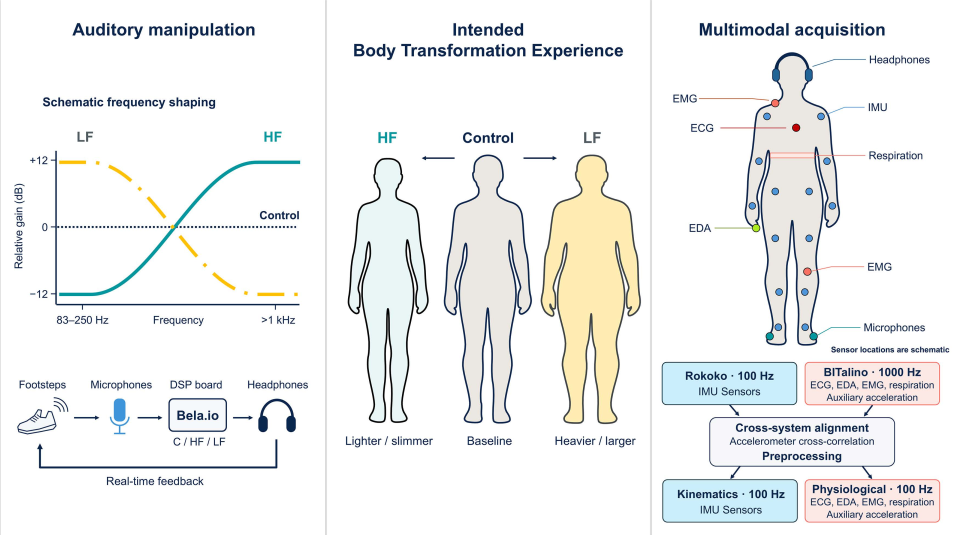

# BODYinTRANSIT

Research code for the RoSA benchmark reported in **“BODYinTRANSIT: A Multimodal Dataset for Investigating Sensory-Driven Transformations in Body Perception and Affective Experiences.”**

This repository contains the training and analysis code. It does **not** contain the BODYinTRANSIT dataset, trained checkpoints, or the third-party pretrained weights. The dataset is sensitive and is available under an End-User Licence Agreement (EULA).

## Experimental overview



*Experimental framework for BODYinTRANSIT. Self-generated footsteps are modified and played back in real time; the study records kinematics and physiological signals, which are aligned during preprocessing. Sensor locations and intended body transformations are schematic. [PDF figure](Acquisition_Overview.pdf).*

## Dataset access

Researchers can [request access to the BODYinTRANSIT dataset](https://imbodylab.com/data/bodyintransit-dataset-access/). Access requires completing and signing an End-User Licence Agreement (EULA); approved researchers receive credentials to the secure repository at Universidad Carlos III de Madrid.

After obtaining access, place the files in the following layout:

```text
dataset/
├── unified_db/       # Unified sensor CSV files
└── allLabels/
    ├── labels.xlsx
    └── demographics_v2.xlsx
```

`labels.xlsx` is required for the perceived-weight and happiness tasks. `demographics_v2.xlsx` is used by paper-figure analysis. Dataset files are not included in this repository.

## Pretrained weights

To obtain `harnet5_weights.pth`, download it from the original authors' [ssl-wearables repository](https://github.com/OxWearables/ssl-wearables) and place it at:

```text
src/weights/harnet5_weights.pth
```

`src/models.py` loads the checkpoint from this path.

## Environment

The code requires Python, PyTorch, and the packages in [`requirements.txt`](requirements.txt). Install the PyTorch build suitable for your CPU/GPU and CUDA setup first, then install the remaining dependencies:

```bash
python -m pip install torch
python -m pip install -r requirements.txt
```

The provided [`Dockerfile`](Dockerfile) starts from a PyTorch image and installs `requirements.txt`; check that its PyTorch/CUDA image tag is suitable for your machine before building:

```bash
docker build -t bodyintransit .
```

## Reproduce the benchmark

Run commands from `src/`, because the scripts use paths relative to that directory. Make sure the dataset and pretrained checkpoint are in place first.

`train.py` processes every ID in `subjectIds.json` and runs ten seeds (1–10) for the selected task. It defaults to 100 epochs, batch size 64, and learning rate `1e-4`, with early stopping. The default task is `happiness`; run each task into its corresponding results directory:

```bash
cd src
python train.py --task condition --output_dir ../results_condition
python train.py --task weight --output_dir ../results_weight
python train.py --task happiness --output_dir ../results_happiness
```

The three task names are `condition`, `weight`, and `happiness`. Use `--help` to see the training options. Re-running a task writes participant result files with the same names, so move or back up results before starting a run you want to keep. Result directories are ignored by Git.

Once all task results have been generated, run the analysis scripts from `src/`:

```bash
python create_paper_figures.py
python analyze_results.py
python plot_sensor_importance_global.py
python plot_sensor_importance_individual.py
python summarize_per_participant.py --task condition
python summarize_per_participant.py --task weight
python summarize_per_participant.py --task happiness
```

The figure and summary scripts expect the result folders above; metadata-dependent analyses also require the corresponding files in `dataset/allLabels/`. The sensor-importance scripts select a task through the `TARGET` setting near the top of each script.

## Repository contents

- `src/train.py`, `src/dataset.py`, and `src/models.py`: benchmark training, data loading, and RoSA model.
- `src/create_paper_figures.py`, `src/analyze_results.py`, `src/summarize_per_participant.py`, and the sensor-importance scripts: post-training analyses and figures.
- `src/accelerometer_columns.txt`: accelerometer feature columns used by the benchmark.
- `dataset/`, `results/`, and `checkpoints/`: empty placeholders; contents are not tracked.

The manuscript source, raw data, generated visualizations, local checkpoints, and pretrained weight binary are intentionally not part of this repository.

## License and citation

The code is available under the MIT License; see [`LICENSE`](LICENSE). Dataset access is governed by its EULA, and the pretrained checkpoint is governed by the upstream authors' terms. The MIT License does not grant rights to either.

Please cite the BODYinTRANSIT paper:

> [Authors]. “BODYinTRANSIT: A Multimodal Dataset for Investigating Sensory-Driven Transformations in Body Perception and Affective Experiences.” [Publication details and DOI to be added.]
# BODYinTRANSIT

Research code for the RoSA benchmark reported in **“BODYinTRANSIT: A Multimodal Dataset for Investigating Sensory-Driven Transformations in Body Perception and Affective Experiences.”**

This repository contains the training and analysis code. It does **not** contain the BODYinTRANSIT dataset, trained checkpoints, or the third-party pretrained weights. The dataset is sensitive and is available under an End-User Licence Agreement (EULA); please do not put dataset files or generated participant-level results in this repository.

## Dataset access

To request access, contact Ana Tajadura-Jiménez or Fernando Díaz-de-María and complete the EULA described in the paper's Data Availability section. The dataset is then provided through the secure repository at Universidad Carlos III de Madrid.

After obtaining access, place the files in the following layout:

```text
dataset/
├── unified_db/       # Unified sensor CSV files
└── allLabels/
    ├── labels.xlsx
    └── demographics_v2.xlsx
```

`labels.xlsx` is required for the perceived-weight and happiness tasks. `demographics_v2.xlsx` is used by paper-figure analysis. The data are intentionally excluded from Git.

## Pretrained weights

`models.py` loads the five-second HarNet checkpoint from:

```text
src/weights/harnet5_weights.pth
```

The checkpoint is not distributed here because redistribution permission has not been established. Obtain it from the original authors' [ssl-wearables repository](https://github.com/OxWearables/ssl-wearables), follow their download instructions and terms, and place the file at the path above. See [`src/weights/README.md`](src/weights/README.md) for the upstream citation.

The included `src/sensorRangeQuantiles.pth` is a separate preprocessing artifact used by the dataset loader.

## Environment

The code requires Python, PyTorch, and the packages in [`requirements.txt`](requirements.txt). Install the PyTorch build suitable for your CPU/GPU and CUDA setup first, then install the remaining dependencies:

```bash
python -m pip install torch
python -m pip install -r requirements.txt
```

The provided [`Dockerfile`](Dockerfile) starts from a PyTorch image and installs `requirements.txt`; check that its PyTorch/CUDA image tag is suitable for your machine before building:

```bash
docker build -t bodyintransit .
```

## Reproduce the benchmark

Run commands from `src/`, because the scripts use paths relative to that directory. Make sure the dataset and pretrained checkpoint are in place first.

`train.py` processes every ID in `subjectIds.json` and runs ten seeds (1–10) for the selected task. It defaults to 100 epochs, batch size 64, and learning rate `1e-4`, with early stopping. The default task is `happiness`; run each task into its corresponding results directory:

```bash
cd src
python train.py --task condition --output_dir ../results_condition
python train.py --task weight --output_dir ../results_weight
python train.py --task happiness --output_dir ../results_happiness
```

The three task names are `condition`, `weight`, and `happiness`. Use `--help` to see the training options. Re-running a task writes participant result files with the same names, so move or back up results before starting a run you want to keep. Result directories are ignored by Git.

Once all task results have been generated, run the analysis scripts from `src/`:

```bash
python create_paper_figures.py
python analyze_results.py
python plot_sensor_importance_global.py
python plot_sensor_importance_individual.py
python summarize_per_participant.py --task condition
python summarize_per_participant.py --task weight
python summarize_per_participant.py --task happiness
```

The figure and summary scripts expect the result folders above; metadata-dependent analyses also require the corresponding files in `dataset/allLabels/`. The sensor-importance scripts select a task through the `TARGET` setting near the top of each script.

## Repository contents

- `src/train.py`, `src/dataset.py`, and `src/models.py`: benchmark training, data loading, and RoSA model.
- `src/create_paper_figures.py`, `src/analyze_results.py`, `src/summarize_per_participant.py`, and the sensor-importance scripts: post-training analyses and figures.
- `src/sensorRangeQuantiles.pth` and `src/accelerometer_columns.txt`: preprocessing inputs used by the benchmark.
- `dataset/`, `results/`, and `checkpoints/`: empty placeholders; contents are not tracked.

The manuscript source, raw data, generated visualizations, local checkpoints, and pretrained weight binary are intentionally not part of this repository.

## License and citation

The code is available under the MIT License; see [`LICENSE`](LICENSE). Dataset access is governed by its EULA, and the pretrained checkpoint is governed by the upstream authors' terms. The MIT License does not grant rights to either.

If you use the pretrained representation, please cite the original work:

> Yuan, H. et al. “Self-supervised learning for human activity recognition using 700,000 person-days of wearable data.” *npj Digital Medicine*, 7, 91 (2024). https://github.com/OxWearables/ssl-wearables

Please also cite the BODYinTRANSIT paper when using this benchmark; add its final publication details when available.
